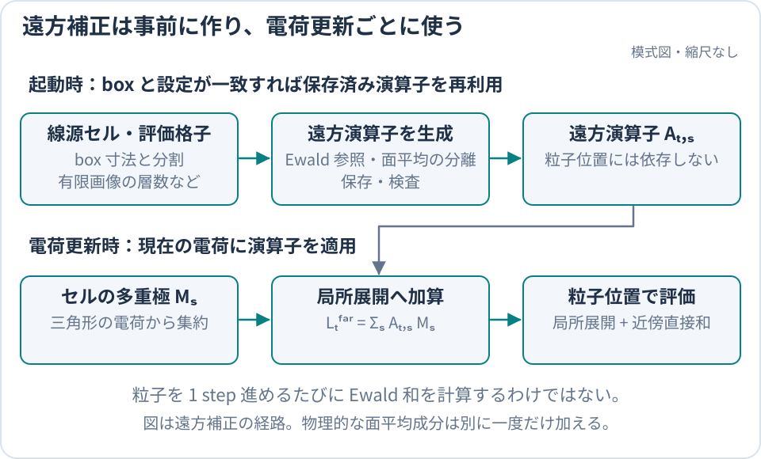

title: periodic2遠方補正

# periodic2遠方補正

`cached_kneq0` は、有限画像の FMM と、周期 box に固定した遠方補正演算子を組み合わせます。
このページは演算子の生成、面平均の分離、保存と再利用の正本です。
物理的な境界条件は [periodic2 静電場](../models/PeriodicElectrostatics.md)を参照してください。



遠方補正の高価な参照計算は演算子生成時に行い、粒子追跡では更新済みの局所展開を使います。

## 設定と保存先

```toml
[domain]
box_min = [0.0, 0.0, 0.0]
box_max = [1.0e-4, 1.0e-4, 3.2e-4]
periodic_axes = ["x", "y"]

[fields]
boundary = "periodic2"

[fields.solver]
method = "fmm"

[fields.periodic]
backend = "cached_kneq0"
image_layers = 1
generation_tolerance = 1.0e-8
# cache_dir = "/shared/project/beach-cache/periodic2"  # 明示的な保存先が必要な場合
```

`fields.periodic.cache_dir` を省略すると、次の順で保存先を決めます。空の環境変数は未設定と扱います。

1. `$BEACH_CACHE_DIR/periodic2`
2. `$XDG_CACHE_HOME/beach/periodic2`
3. `$HOME/.cache/beach/periodic2`

明示したパスを最優先し、相対パスは実行時の作業ディレクトリから解釈します。
解決した保存先とファイルは `summary.txt` の `periodic2_cache_dir` / `periodic2_cache_path` に出力します。
`field_reconstruction_periodic_*` の既存の再構成情報も維持します。

| `fields.periodic.backend` | 計算内容 |
| --- | --- |
| `finite_images` | 指定した有限画像だけ |
| `cached_kneq0` | 有限画像と、保存済み演算子による無限周期の非零モード |
| `panel_spectral_reference` | 三角形要素の Fourier 和による検証用の非零モード |

## box に固定した線源セルと評価側 anchor

遠方補正の線源は、`domain.box_min..box_max` を軸ごとに $n_x\times n_y\times n_z$ に分けた直方体セルです。
分割数は軸ごとに選びます。評価側 anchor は、セルの半対角線が $0.5\min(L_x,L_y)$ 以下になるまで、
最も幅の広い軸を 1 ずつ増やして決めます（周期軸は 2 以上）。線源セルは anchor の格子から始め、
半対角線が $0.4\min(L_x,L_y)$ 以下になるまで最も幅の広い軸の分割数を 2 倍にします。
どのセルもほぼ立方体になるので、箱の高さが周期長より大きくても横方向の分割は細かくなりません。
たとえば $0.1\times0.1\times1$ mm の箱では anchor $2\times2\times15$、線源セル $2\times2\times30$ です。
anchor は適応木の節点ではなく、点評価のときに点を含む anchor の局所展開を葉の局所展開に加えます。
演算子はセルの幾何だけで決まりますが、作るのは要素を含むセルだけです。
内部 FMM オプションで分割数を明示した場合は、その値を使います。

各要素は、周期 box 内へ戻した重心の属する線源セルへ割り当てます。非周期軸の上端は最後のセルに含めます。
セル中心を展開中心にした三角形平均の P2M 基底を初期化時に計算し、電荷更新ごとに要素電荷を掛けて集計します。
この追加処理は要素数 × 係数数に比例します。
近傍の三角形直接和と有限画像の適応 FMM 木は引き続き使い、`cached_kneq0` の線源の代表座標は box 内に固定します。

仮想線源（proxy）は、セルの各面へ同じ厚さを足した直方体表面に置きます。
直方体の半対角線がセル半対角線の **1.5 倍**になる厚さを選びます。
セルを包む余裕を確保しつつ、縦長のセルで x/y の仮想線源を必要以上に遠ざけて高次の打切り誤差を増やすことを避けます。
この殻は box 寸法と分割数だけで決まり、要素形状では拡大しません。
初期化時に全頂点が担当セルの殻に収まることを検査し、超える要素は設定エラーにします。
その場合はメッシュを細分化してください。内部 API で線源の分割数を指定する場合は、粗くしてセルを広げる選択もありますが、
遠方近似誤差を再検証する必要があります。

## 並進と鏡映による生成の共有

線源セル $s$ の多重極係数を $M_s$、評価側セル $t$ の局所展開を $L_t$ とすると、

$$
L_t^{\mathrm{far}}=\sum_s A_{t,s}M_s
$$

です。生成器タグは `periodic-kneq0-generator-v12` です。

1. 共通の仮想線源配置から、多重極への写像と最小ノルム擬似逆を 1 回作ります。
   外側とその 0.85 倍の直方体を組み合わせ、実行時の次数より 2 次高いモーメントまで拘束します。
   保存する写像では追加のモーメントを 0 とし、仮想電荷が未使用の高次成分を作る誤差を抑えます。
2. 評価側の照合点を、内部点と x/y の対向する 4 面の点の和集合として作ります。
   各セルは実際に周期境界へ接する面だけを選び、面の組合せごとに正則化 QR 分解を 1 回準備します。
3. 評価側と線源側の中心差を、線源格子の半格子間隔で整数化します（anchor の間隔は線源間隔の 2 の冪倍）。
   高価な Ewald 残差は同じ相対オフセットで共有します。
4. 点群を各軸の鏡映に閉じた組で置き、オフセットの符号も共有します。
   点の添字を鏡映し、電場ベクトルの対応成分の符号を戻します。電位は符号を変えません。
5. 各組の絶対座標で、下記の面平均の滑らかな残りを高さ間隔 $L/64$ 以下の表から 3 次 Hermite 補間して加え、局所係数を求めます。
   電位の定数項は、同じ照合点の電位残差から別に求めます。
6. 仮想線源から局所展開への写像と擬似逆を合成し、(評価セル, 線源セル) の組の演算子にします。
   相対オフセットの類は、今回作る線源セルとの組に現れるものだけを評価します。

周期境界に接する面が違っても、高価な核評価は和集合で共有します。最小二乗の重みは内部点と境界面の集合で
総重みが等しくなるように定めます。多重極行列と QR は長さの次数を正規化して解き、µm 単位でも高次係数を保ちます。

MPI はオフセットの類を巡回して各 rank へ分配し、OpenMP は仮想線源の列を並列評価します。分配に使う MPI 文脈は
simulator と `--prepare-periodic-cache` が渡し、渡さない呼び出し（C ABI、テスト）は単一 rank で全類を作ります。
全 rank の演算子を集約した後、MPI root だけが既存の lock と checksum 付き atomic publish で保存します。

## 面平均を分離する

Ewald 和は生成時だけの参照です。分割値 `fields.periodic.ewald_alpha` は遮蔽長ではなく、
実空間と逆空間の計算量を配分します。0 なら周期長から自動決定します。
`fields.periodic.ewald_layers` は両方の和の打切り深さです。
有限画像の層数は通常の FMM と参照から差し引く側で一致させます。

有限画像殻の面平均は、対称な無限面電荷の平均場と、滑らかな残り $s$ の和です。
平均をとる面は mesh ではなく周期 box の x/y 範囲に固定します。
$s$ は線源の絶対 x/y と高さの差に依存するので、並進・鏡映で共有する Ewald 残差には混ぜず、各組で評価します。
実行時は各要素の高さの表から $S(z)=\sum_i q_i s_i(z)$ を引きます。
高さの表は間隔 $L/32$ 以下の 3 次 Hermite 補間で、電場を同じ多項式の微分から求めます。

$$
K_{k\ne0}=K_\mathrm{shell}+\mathcal F[K_\mathrm{Ewald}^{\mathrm{full}}-K_\mathrm{shell}+s]
-K_0^\mathrm{sym}-S
$$

物理的な平均場はこの演算子の外で一度だけ加えます。全線源より上では累積電荷を総電荷で厳密に固定します。
電荷更新では通常の P2M/M2M/M2L の後、L2L の前に $\sum_s A_{t,s}M_s$ を加えます。
粒子評価では局所展開と近傍直接和だけを使い、Ewald 和を再評価しません。

## 一致条件と事前生成

fingerprint は box の最小・最大座標、周期軸と周期長、両格子の各軸の分割数、次数と係数数、
Ewald 分割値と打切り層数、有限画像層数、核と softening、殻倍率、照合点の定数、生成許容誤差と生成器タグから決めます。
mesh、適応木の節点位置・半径・節点 ID、電荷、BEACH のビルド識別子は含めません。
同じ box と設定なら、異なる物体集合や異なる作業ディレクトリでも同じ保存先から再利用できます。
保存時の評価側の番号は anchor 格子の順序で、適応 target tree には依存しません。

cache ファイルは線源セル単位で育ちます。初期化では要素を含むセルを列挙し、保存済みのセルはそのまま読み込み、
足りないセルだけを作ってから、lock を取ったうえで保存済みのセルと合わせて書き直します（lock 待ちの間に他の job が
足したセルは読み直して使います）。同じ box で別の物体集合を走らせるたびに必要なセルが増えていき、全セルがそろえば
どの物体集合でも生成なしで始まります。`periodic2_cache_hit` は必要なセルがすべて cache にあったとき `T`、
1 つでも作ったときは `F` で、`periodic2_operator_build_count` が 1 増えます。メモリ上の演算子も要素を含むセルの分だけです。

```bash
# cache 用の短い job: 本番より多い rank で生成だけを済ませる
export BEACH_CACHE_DIR=/path/to/shared/beach-cache
srun -n 16 beach --prepare-periodic-cache beach.toml
# 本番 job（cache job の後）: 生成なしで始まる
srun -n 4 beach beach.toml
```

生成は相対オフセットの類を MPI rank へ巡回分配し、各類の組の局所 fit も同じ rank が受け持ちます。
rank 数は類の数まで効き、各 rank では仮想線源の列を OpenMP で並列化します。

事前生成はメッシュの殻への収容を検査し、演算子を生成または読み込んで終了します。
結果と checkpoint は書かず、再開設定も無視します。
標準出力の `prepare_elapsed_s`、`periodic2_cache_hit`、`periodic2_operator_build_count`、
`periodic2_cache_fingerprint`、`periodic2_cache_path` で確認します。
通常実行では同じ項目を `summary.txt` で確認します。

## 精度の確認

- `image_layers` と Ewald の設定を変え、有限画像との分割や参照の打切りに依存しないことを確かめます。
- 作り直した演算子と保存済み演算子で、電場・電位が丸め誤差内で一致することを確かめます。
- `make test-fortran-far-correction` で一様面電荷の非零モードの面平均漏れを検査します。
- 上部真空では独立な三角形 Fourier 和と比較し、面平均と横方向の誤差を別々に確認します。
  上端 H での精度は [上部真空の Fourier 切替](../models/PeriodicElectrostatics.md#上部真空の-fourier-評価への切替)も併用して検証します。

有限状態の誤差や許容差の未達は精度診断として扱います。checkpoint の形式は演算子の生成方式とは独立です。
