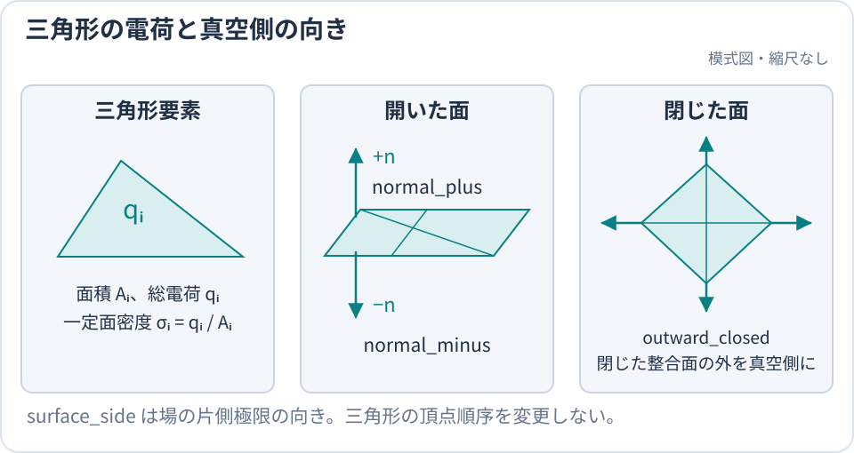

title: ケース設計の流れ

# ケース設計の流れ

設定ファイルは `run / domain / mesh / particles / fields / sheath / output` の7グループ形式だけを受け付けます。完全な入力例は `examples/` を参照してください。

このページは、動作確認済みの公式チュートリアルを研究用ケースへ変更するときの判断順を示します。
形状・粒子源・境界を選び、時間刻みと粒子数を決めて、比較できる計算結果を作ります。
各キーの型、既定値、組合せ制約は[入力パラメータリファレンス](../reference/Parameters.md)で調べられます。

**出発点:** [入門チュートリアル](../start/Tutorial.md)を完了し、`beach.toml` と
`outputs/tutorial` がある作業ディレクトリで、基準設定を複製します。

```bash
cp beach.toml case.toml
beachx lint case.toml
```

以降は一つの判断だけを変更し、そのたびに `beachx lint case.toml` を実行します。チュートリアルの
出力は基準結果として残し、新しい出力先は手順 8 で指定します。

## 1. 目的と合格条件を決める

設定を編集する前に、次を一文ずつ書き出します。

- どの表面へ、どの環境から粒子が到達するか
- 観測したい量は電荷、電位、吸収率、escape、または計算時間のどれか
- どの保存則、基準解、収束幅を満たせば結果を採用するか

公式チュートリアルは batch 間の帯電 feedback を学ぶ教材です。そこで使う粒子重みや
`run.batch.duration_s=0` を、そのまま特定の実環境の時間発展とは解釈できません。先に合格条件を決めると、
後の mesh 分割、粒子数、solver 精度を必要な範囲へ絞れます。

## 2. 形状を選ぶ

簡単な形状は組み込み template、実測形状や CAD 由来形状は三角形面を持つ OBJ を使い、
どちらも `[[mesh.parts]]` に並べます。複数の独立した物体、特に独立した導体は別々の parts として
`mesh_id` を分けます。

| `kind` | 形状 | 主な寸法 | 主な分割数 |
| --- | --- | --- | --- |
| `obj` | OBJ ファイル | `path`, `scale`, `rotation`, `offset` | ファイル内の面 |
| `plane` | XY 長方形平面 | `size_x`, `size_y` | `nx`, `ny` |
| `plate_hole`, `plane_hole` | 円形穴付き長方形平面（後者は別名） | `size_x`, `size_y`, `radius` | `n_theta`, `n_r` |
| `disk` | 円板 | `radius` | `n_theta`, `n_r` |
| `annulus` | 同心リング | `radius`, `inner_radius` | `n_theta`, `n_r` |
| `box` | 閉じた直方体表面 | `size` | `nx`, `ny`, `nz` |
| `cylinder` | z 軸方向の円柱 | `radius`, `height`, `cap` | `n_theta`, `n_z` |
| `sphere` | 球面 | `radius` | `subdivisions`（`n_lon`, `n_lat` を書くと UV 球） |

たとえば、チュートリアルの平面を球へ置き換える場合は、既存の `[[mesh.parts]]` block だけを
次のように置き換えます。

```toml
[[mesh.parts]]
kind = "sphere"
enabled = true
surface_side = "outward_closed"
center = [0.5, 0.5, 0.5]
radius = 0.2
subdivisions = 2
```

球は正二十面体を `subdivisions` 回分割した、要素の大きさがほぼ一様な面になります。
`n_lon`, `n_lat` を書くと経度・緯度分割の UV 球になり、極に近い要素ほど小さくなります。

OBJ 要素も同じ `[[mesh.parts]]` block に書きます。template と混在させるには、末尾に追加します。

```toml
[[mesh.parts]]
kind = "obj"
path = "examples/tetrahedron.obj"
surface_side = "outward_closed"
surface_model = "insulator"
```

`outward_closed` は、面の向きが整合した閉じた two-manifold にだけ使えます。開いた面では、OBJ の面法線と
真空側に応じて `normal_plus` または `normal_minus` を選びます。配置変換、要素数、各形状の制約は
[組み込み形状と OBJ のリファレンス](../reference/Parameters.md#mesh)、複数形状の実例は
[`examples/beach.toml`](https://github.com/Nkzono99/BEACH/blob/main/examples/beach.toml)を参照してください。



`surface_side` は場を評価する真空側を指定し、閉じた整合面では `outward_closed` が外側を解決します。

## 3. 表面 model を選ぶ

| 目的 | `surface_model` | 現行モデルの範囲 |
| --- | --- | --- |
| 命中位置へ電荷を蓄積する | `insulator` | 表面内伝導、bulk 漏洩、誘電分極を解かない |
| 物体の総電荷を保って等電位化する | `conductor` | 浮遊導体。free-space と `periodic2` の両方で使える |

チュートリアルは `insulator` です。導体へ変える場合は対象の `[[mesh.parts]]` で
次の 1 行を変更します。

```toml
# 対象の既存 mesh.parts 内で変更
surface_model = "conductor"
```

`dielectric`、`epsilon_r`、抵抗性表面は現行入力では利用できません。導体へ変えたケースは、チュートリアルの
結果を基準にせず、物体電位と総電荷を別に検証します。モデルの意味と制約は
[表面はどう帯電するか](../models/SurfaceModels.md)を参照してください。

## 4. 粒子源を選ぶ

粒子をどこから供給するかで経路を選びます。`source.mode` を変更するときは、旧 mode 専用キーを残さず、
その species entry を専用ページの最小設定へ置き換えます。

| `source.mode` | 新しいケースでの用途 | 物理的な供給量 | macro sampling の調整 |
| --- | --- | --- | --- |
| `volume_seed` | box 内へ指定個数を置く軌道試験や初期粒子 | 面流束には対応しない | `sampling.volume_macro_particles_per_batch` |
| `photo_raycast` | 照射 ray が命中した表面から放出 | 電流密度 × 投影面積 × `run.batch.duration_s` | `sampling.rays_per_batch` と ray の命中率 |
| `secondary_emission` | 吸収時に入射種から生成。同一バッチで追跡 | [二次電子放出](../models/SecondaryElectronEmission.md) |

チュートリアルの `volume_seed` を維持して供給量や領域だけ変えるなら、既存 species entry の次の値だけを
調整します。

```toml
[particles.species.sampling]
volume_macro_particles_per_batch = 500

[particles.species.source]
pos_low = [0.2, 0.2, 0.8]
pos_high = [0.8, 0.8, 0.8]

[particles.species.distribution]
drift_velocity_m_s = [0.0, 0.0, -1.0e6]
```

外部 plasma から非周期の box 面全体を通す流入は `source.mode` ではなく
`[particles.species.inflow]` です。境界流入だけの species では、物理パラメータと流入面を指定し、
`source.mode` と `sampling.volume_macro_particles_per_batch` は省略します。選択の詳細は
[粒子をどこから入れるか](ParticleSourcesBoundaries.md)、境界流入は
[境界から粒子を流入させる](ReservoirInjection.md)、光電子は
[光電子の放出とライフサイクル](../models/PhotoelectronEmission.md)を参照してください。

## 5. box・場境界・粒子境界を決める

まず `[domain]` の box が mesh と到達しうる全粒子軌道を含むようにします。次に場の closure を
`fields.boundary`、非周期面を出る粒子の作用を `[particles.boundary]` で選びます。

| 判断 | 選択 |
| --- | --- |
| 有限物体の自由空間場 | `periodic_axes=[]`, `fields.boundary="free"` |
| x/y に無限反復する場 | `periodic_axes=["x", "y"]`, `fields.boundary="periodic2"` |
| 非周期面を出た粒子 | `open`, `reflect`, `redistributed_reflect` |

周期 topology を指定する公開キーは `domain.periodic_axes` だけです。`particles.boundary` や species 別境界で
周期軸を追加、削除、上書きはできません。`periodic2` は x/y 周期・z 非周期に限定されるため、新しく使う場合は
完全例 [`examples/periodic2_basic.toml`](https://github.com/Nkzono99/BEACH/blob/main/examples/periodic2_basic.toml)
と [periodic2 静電場](../models/PeriodicElectrostatics.md)から始めてください。粒子の escape と return は
[粒子の escape と return](../models/ParticleEscapeReturn.md)にまとめています。

## 6. solver を選ぶ

| `fields.solver.method` | 選ぶ場面 | 確認方法 |
| --- | --- | --- |
| `direct` | 小規模計算と基準解 | 近似 solver の比較基準にする |
| `treecode` | 中規模の自由空間計算 | opening 条件を変えて観測量を比較する |
| `fmm` | 大規模計算、多数の評価点、通常の `periodic2` | `fields.solver.tree.theta` と `fields.solver.tree.leaf_max` を変えて Direct と比較する |
| `auto` | 自由空間で要素数に応じ自動選択 | 出力で実際に選ばれた solver を確認する |

チュートリアルの基準計算は `fields.solver.method="direct"` のまま残します。高速 solver を採用する前に、同じ mesh と
粒子条件を縮小したケースで Direct との差を測ります。互換性と選択基準は
[場の評価方法](FieldSolvers.md)、FMM の設定と精度調整は [FMM を使う](FMM.md)を参照してください。

吸収時の `secondary_emission` は独立した注入源を持たない種です。入射種の放出条件と組にして設定します
（[二次電子放出](../models/SecondaryElectronEmission.md)）。

## 7. 時間と粒子数を決める

先に密度、温度、流束などの物理条件を決め、その条件を何個のマクロ粒子で表現するかを決めます。
マクロ粒子の重み `sampling.weight` は、一つの計算粒子が代表する実粒子数です。

| 決めるもの | 設定 | 選び方 |
| --- | --- | --- |
| 粒子軌道の刻み | `particles.tracking.dt_s` | 半分にして衝突位置や吸収率の変化を調べる |
| 一粒子を追跡する長さ | `particles.tracking.max_steps_per_particle` | 未解決粒子 `survived_max_step` の影響が十分小さくなるまで増やす |
| 表面電荷を更新する幅 | `run.batch.duration_s` | 流束源では正の秒数を指定し、半分の幅でも結果を比較する |
| 計算する期間 | `run.batch_count` | 固定幅なら `run.batch.duration_s × batch_count` が物理終了時刻になる |

軌道刻みを半分にする比較では、`particles.tracking.max_steps_per_particle` を 2 倍にして追跡可能な時間も揃えます。
`run.batch.duration_steps` を使う場合は `run.batch.duration_s = particles.tracking.dt_s × run.batch.duration_steps` なので、
`particles.tracking.dt_s` だけを変えると電荷更新幅も変わります。まず秒単位の `run.batch.duration_s` で両者を独立に指定すると、
どちらの影響を比較しているか明確になります。この二つの幅の指定は排他です。

粒子数の調整方法は、選んだ粒子源で異なります。

| 粒子源 | 統計精度を上げるときの変更 | 固定する物理条件 |
| --- | --- | --- |
| `volume_seed` | `sampling.volume_macro_particles_per_batch` を増やし、`sampling.weight` を同じ比率で減らす | 1 batch の実粒子数 `sampling.volume_macro_particles_per_batch × sampling.weight` |
| `inflow` | `sampling.target_macro_particles_per_batch` を増やす、または固定 `sampling.weight` を減らす。両方は指定しない | 分布、密度または流束、面積、`run.batch.duration_s` |
| `photo_raycast` | `sampling.rays_per_batch` を増やす | 光電流密度、照射方向、形状、`run.batch.duration_s` |

`sampling.volume_macro_particles_per_batch` は **1 batch 当たり**の生成数です。例えば入門ケースの
`sampling.volume_macro_particles_per_batch=200, sampling.weight=4000` を `400, 2000` にすると、投入する実粒子数を保って
標本数を 2 倍にできます。粒子数だけを増やすと、投入電荷も増えて別の物理条件になります。
光電子のマクロ粒子数は ray の命中率にも依存します。

`volume_seed` でも、入門ケースのように `run.batch.duration_s` を与えれば、1 batch の実粒子数から電流が決まります
（電流 = 粒子数 × 重み × 電荷 ÷ `run.batch.duration_s`）。時間幅比較と適応進行は
[`run.batch.duration_s` をどう決めるか](BatchDurationStability.md)を参照してください。

## 8. 出力先を分けて実行する

最後に、既存の `[output]` で `dir` だけを変更し、基準結果を上書きしない出力先へ分けます。

```toml
[output]
dir = "outputs/case"
```

HPC では login node で simulation を直接実行せず、計算 node の割当内で `beach case.toml` を実行します。

```bash
beachx lint case.toml
beach case.toml
beachx inspect outputs/case
```

ローカル実行、MPI、checkpoint と再開は[実行・再開する](Execution.md)を参照してください。

最小の合格条件は、`lint` が `status=ok`、実行が終了 code 0、`inspect` の `batches` が
`run.batch_count` と一致し、`summary.txt` と `charges.csv` が存在することです。これは完走した証拠であり、
物理的に正しい証拠ではありません。各出力の読み方は[出力ファイルを調べる](OutputGuide.md)を参照してください。

## 9. 妥当性を確認する

目的に対応する観測量について、少なくとも次を確認します。

- `processed_particles = absorbed + escaped` が成り立ち、`escaped` の内訳である `escaped_boundary`、
  `survived_max_step`、`multiple_box_events_soft_discarded` を説明でき、表面・放出を含む電荷 ledger が閉じる
- mesh を細分化しても結論が変わらない
- `particles.tracking.dt_s`、`particles.tracking.max_steps_per_particle`、`run.batch.duration_s`、batch 数、粒子数を変えても結論が許容幅内にある
- Treecode や FMM の小規模結果が Direct の基準結果と一致する
- 乱数 seed または反復実行を変えた統計変動が許容幅内にある
- 採用する結論が、選んだ表面 model、境界、粒子源の適用範囲を超えない

変更前後を同じ物理量・同じ時刻で比較し、一度に複数の数値条件を変えません。具体的な確認コマンドと
採用基準は[計算結果の妥当性確認](ValidationGuide.md)に従ってください。
