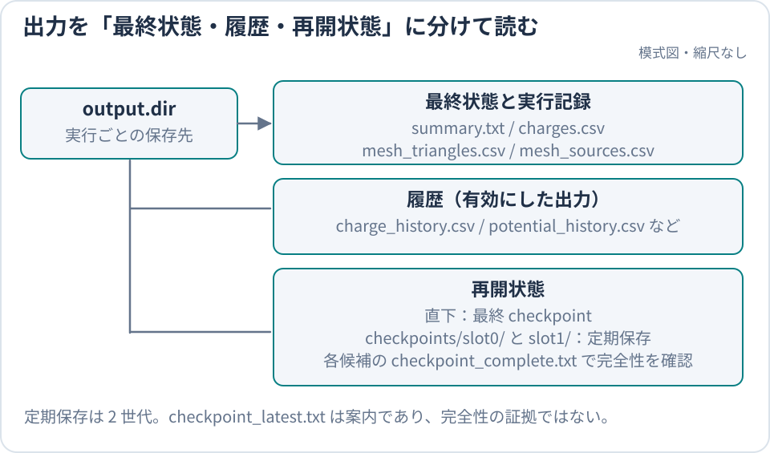

title: 出力ファイルを調べる

# 出力ファイルを調べる

> **質問:** 公式チュートリアルは正常に終わり、表面電荷は保存則と整合していますか。
>
> **一文での回答:** まず `beachx inspect` で実行件数を確認し、次に `charges.csv` と
> `charge_ledger.csv` で最終表面電荷と粒子の行き先を照合します。

読了後には、公式ケースの実行完了を判定し、最終電荷、mesh、species 別電荷収支、履歴、電位を
順に確認できます。モデル固有の receipt、完全な列定義、checkpoint schema は
[出力形式リファレンス](../reference/OutputReference.md)に分離しています。

## 公式入門ケースの結果を確認する

[入門チュートリアル](../start/Tutorial.md)を実行したディレクトリで、`beach.toml` の
`output.dir` に指定された結果を調べます。公式入門ケースでは `outputs/tutorial` です。

```bash
beachx inspect outputs/tutorial
```

少なくとも次の行が含まれます。

```text
directory=outputs/tutorial
processed_particles=15350054
absorbed=737481
escaped=14612573
batches=10000
last_rel_change=...
simulated_time_s=5.000000e+00
charge_sum=-3.339396e-12
```

最小合格条件は次のとおりです。

- `beach` と `beachx inspect` の終了コードが `0`
- `batches=10000` が `beach.toml` の `run.batch_count=10000` と一致する
- `processed_particles=15350054` が `charge_ledger.csv` の流入数（電子 14999999、陽子 350055）の和と一致する
- `simulated_time_s` が `run.batch.duration_s` × `run.batch_count` = 5 s と一致する
- `outputs/tutorial/summary.txt` と `outputs/tutorial/charges.csv` が存在する

`absorbed=737481`、`escaped=14612573`、`charge_sum=-3.339396e-12` は、現行版、`rng_seed=12345` での参照値です。
このケースの結果は thread 数によりませんが、乱数実装が変わった版では乱数列に依存する値まで同一であるとは仮定しません。

この判定が示すのは実行完了だけです。`last_rel_change` と `output.diagnostics.charge_rel_change_threshold` は自動停止条件ではなく、
数値収束や物理的妥当性は[計算結果の妥当性確認](ValidationGuide.md)で別に判定します。
コマンドが失敗する、または最小条件を満たさない場合は
[トラブルシューティング](Troubleshooting.md)へ進んでください。

## 最初に見るファイル



最終状態と履歴は結果の確認に使い、再開は完了情報を持つ checkpoint 一式から行います。

| 確認したいこと | 最初に見る場所 |
| --- | --- |
| 実行件数、batch 数、最終変化量 | `summary.txt` と `beachx inspect` |
| 最終的な要素電荷 | `charges.csv` |
| 三角形 geometry と mesh ID | `mesh_triangles.csv` |
| mesh ID と入力 mesh の対応 | `mesh_sources.csv` |

### `summary.txt`

`summary.txt` は、実行統計と解決済み設定を `key=value` 形式で記録します。最初は
`processed_particles`、`absorbed`、`escaped`、`batches`、`last_rel_change` を読みます。
モデル固有の key を近くの `beach.toml` から推測せず、実行時の receipt として読む場合は
[構成固有の出力](../reference/OutputReference.md#構成固有の値を探す)を参照してください。

### `charges.csv`

`charges.csv` は最終状態の `elem_idx,charge_C` を持ちます。`charge_C` は各三角形要素の総電荷 [C] で、
表面電荷密度ではありません。公式ケースでは 8 行あり、総和は `beachx inspect` の
`charge_sum=-3.339396e-12` と一致します。

```bash
head -n 3 outputs/tutorial/charges.csv
```

### mesh ファイル

`mesh_triangles.csv` は三角形頂点、要素電荷、`mesh_id` を持ちます。`mesh_sources.csv` は各 `mesh_id` を
入力 mesh、template、表面モデルへ対応付けます。公式ケースは 8 三角形からなる 1 個の plane mesh（浮遊導体）です。

```bash
head -n 3 outputs/tutorial/mesh_triangles.csv
head -n 2 outputs/tutorial/mesh_sources.csv
```

## charge ledger

`charge_ledger.csv` は、各 species の注入、表面吸収、escape、未解決 discard を signed charge と count で
集計します。公式ケースの電子と陽子について、次の短い確認で粒子数、電荷、最終表面電荷を
同時に照合できます。

```bash
python - <<'PY'
import csv
from math import fsum
from pathlib import Path

out = Path("outputs/tutorial")
with (out / "charge_ledger.csv").open(newline="", encoding="utf-8") as f:
    rows = list(csv.DictReader(f))
with (out / "charges.csv").open(newline="", encoding="utf-8") as f:
    surface = fsum(float(item["charge_C"]) for item in csv.DictReader(f))

for row in rows:
    terminal_count = sum(int(row[name]) for name in (
        "absorbed_count", "escaped_count", "discarded_unresolved_count"
    ))
    terminal_charge = fsum(float(row[name]) for name in (
        "absorbed_on_surface_C", "escaped_to_infinity_C", "discarded_unresolved_C"
    ))
    print(f"species {row['species_idx']}: injected={row['injected_count']} terminal={terminal_count} "
          f"charge_C injected={float(row['injected_from_remote_C']):.9e} terminal={terminal_charge:.9e}")
absorbed = fsum(float(row["absorbed_on_surface_C"]) for row in rows)
print(f"surface_C: charges={surface:.12e} absorbed={absorbed:.12e}")
PY

grep -E '^(charge_ledger_surface_charge_after_C|charge_ledger_residual_C)=' \
  outputs/tutorial/summary.txt
```

現行版の参照結果は次の関係を満たします。

```text
species 1: injected=14999999 terminal=14999999 charge_C injected=-1.340297272e-09 terminal=-1.340297272e-09
species 2: injected=350055 terminal=350055 charge_C injected=3.127851952e-11 terminal=3.127851952e-11
surface_C: charges=-3.339395552608e-12 absorbed=-3.339395552610e-12
charge_ledger_surface_charge_after_C= -3.3393955526076921E-12
charge_ledger_residual_C=  1.3148716682030437E-22
```

このケースでは、流入した粒子は吸収、escape、未解決 discard のいずれかへ進みます。表面放出と外部補正が
ないため、電子と陽子の吸収電荷の和は `charges.csv` の総和になります。浮遊導体の再配分は電荷を板の上で動かすだけなので、総和は変えません。`charge_ledger_residual_C` は丸め誤差程度で 0 に
近いことを確認しますが、小さい保存残差だけでは統計収束や物理妥当性を証明できません。
補正を含む一般の保存則と全列は[charge ledger リファレンス](../reference/OutputReference.md#charge-ledger)を参照してください。

## 履歴

公式ケースは 10 batch ごとに電荷と電位を保存します。

| ファイル | 読み取るもの |
| --- | --- |
| `charge_history.csv` | batch ごとの各要素電荷と `rel_change` |
| `potential_history.csv` | batch ごとの各要素電位 |
| `top_reference_history.csv` | box の z-high 面における電位統計 |

```bash
head -n 3 outputs/tutorial/charge_history.csv
head -n 3 outputs/tutorial/potential_history.csv

beachx animate outputs/tutorial \
  --quantity charge \
  --save outputs/tutorial/charge_history.gif \
  --total-frames 30
```

公式ケースでは batch 1, 11, …, 9991 の 1000 snapshot があります。板は導体で一様に帯電するので、全要素が同じ値のまま
負に増え、約 0.5 s で一定になります。板と流入面の電位差は、同じ batch の `potential_history.csv` から
`top_reference_history.csv` の `potential_mean_V` を引いて求めます（[入門チュートリアル](../start/Tutorial.md#4-見積もりと比べる)）。
生成条件と `matching_plane_history.csv` の完全な列は
[履歴リファレンス](../reference/OutputReference.md#履歴)を参照してください。

## mesh 電位

`mesh_potential.csv` は最終状態における各要素重心の電位 [V] です。公式ケースには 8 行あり、
板は導体なので全要素が `1.338411e-05` V です。periodic2 の電位の基準点は任意なので、この値は流入面（box の z-high 面）の
平均電位との差で読みます。
`potential_history.csv` は batch ごとの履歴、`mesh_potential.csv` は最終状態という違いがあります。

電位の基準、periodic2、field reconstruction の条件は
[mesh 電位リファレンス](../reference/OutputReference.md#mesh-電位)にまとめています。

## 再開に使うファイル

再開するときは checkpoint 内のファイルを手作業で結合せず、`run.restart.from` に読み込み元を指定します。
10000 batch の公式結果から 10001 batch 目へ進む操作は
[checkpoint から一度再開する](Execution.md#checkpointから一度再開する)に従ってください。

必須ファイル、periodic slot の選択、schema 互換性を調べる場合だけ
[checkpoint 出力リファレンス](../reference/OutputReference.md#再開に使うファイル)を参照します。

## 構成固有の値を探す

通常の公式ケースには、以下の詳細は必要ありません。使用したモデルまたは診断に対応する行だけを選びます。

| 調べたいもの | 参照先 |
| --- | --- |
| 全ファイルの生成条件 | [ファイル生成条件](../reference/OutputReference.md#ファイル生成条件) |
| field solver、periodic2、粒子境界の解決結果 | [構成固有の receipt](../reference/OutputReference.md#構成固有の値を探す) |
| `zhao_stationary` の signed 電流と補正 | [`zhao_stationary`](../reference/OutputReference.md#zhao_stationary) |
| 外部根を更新したときの外部状態 | [`zhao_stationary`](../reference/OutputReference.md#zhao_stationary) |
| `charge_ledger.csv` の全列 | [charge ledger](../reference/OutputReference.md#charge-ledger) |
| adaptive periodic2 の trial | [適応 batch の診断](../reference/OutputReference.md#適応-batch-の診断) |
| checkpoint schema と必須ファイル | [再開に使うファイル](../reference/OutputReference.md#再開に使うファイル) |
| Python reader の対応属性 | [Python から読む](../reference/OutputReference.md#python-から読む) |

### 適応 batch の診断

`run.batch.adaptive.max_nonzero_mode_potential_step_v > 0` の receipt と、履歴に含まれない棄却 trial は
[適応 batch の診断リファレンス](../reference/OutputReference.md#適応-batch-の診断)で確認します。

## 次へ進む

| 目的 | 次に読むページ |
| --- | --- |
| 電荷・電位を可視化する | [後処理チュートリアル](PostprocessTutorial.md) |
| checkpoint から再開する | [実行・再開する](Execution.md#checkpointから一度再開する) |
| 研究結果として受理できるか調べる | [計算結果の妥当性確認](ValidationGuide.md) |
| 値の不一致や欠落を診断する | [トラブルシューティング](Troubleshooting.md) |
| 出力契約を検索する | [出力形式リファレンス](../reference/OutputReference.md) |

### Python から読む

Python での最初の読込みと可視化は[後処理チュートリアル](PostprocessTutorial.md)、
class と関数の完全な仕様は [Python 後処理 API](../reference/PythonPostprocessAPI.md)を参照してください。
