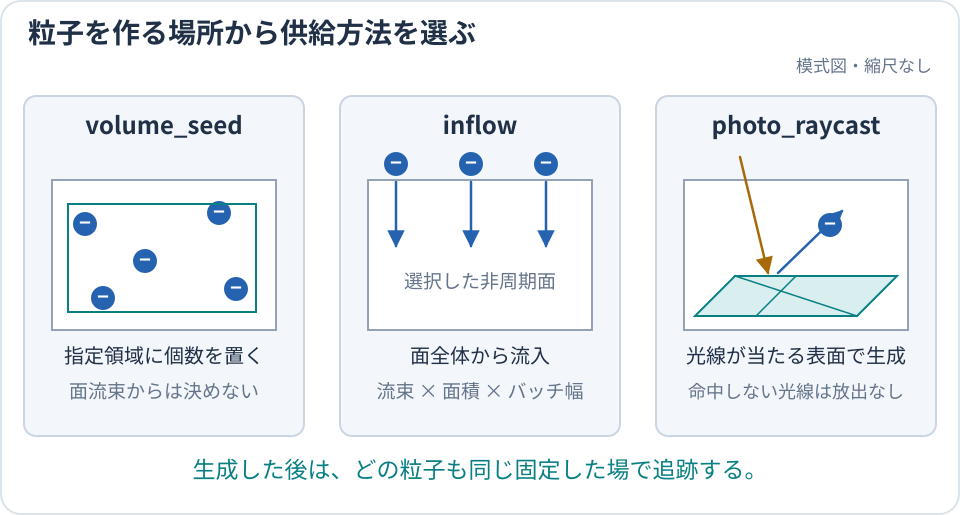

title: 粒子をどこから入れるか

# 粒子をどこから入れるか

このページは、粒子を生成する位置と物理的な供給方法から、使う粒子源を選ぶための案内です。
領域内に粒子を置く方法は `source.mode`、領域外から box 境界を横切らせる方法は
`[particles.species.inflow]` が担当します。

> **選び方の要点:** 指定個数を置くなら `volume_seed`、外部 plasma reservoir から入れるなら
> `inflow`、照射面から光電子を放出するなら `photo_raycast` を使います。

読了後には、粒子源を一つ選び、詳細設定を読むべき専用ページまたはリファレンスへ進めます。

## 生成位置から選ぶ



体積・境界面・表面のどこで生成するかによって、個数を直接与える方法と流束から決める方法を使い分けます。

| 目的 | 選ぶ設定 | 粒子数を決める量 | 生成位置 |
| --- | --- | --- | --- |
| 初期粒子や軌道試験を指定個数で作る | `source.mode="volume_seed"` | `sampling.volume_macro_particles_per_batch` | `source.pos_low` と `source.pos_high` の間 |
| box 外の plasma から流入させる | `inflow` | reservoir 流束 × box 面積 × `run.batch.duration_s` | 非周期の box 面 |
| 光が当たった表面から放出する | `source.mode="photo_raycast"` | 電流密度、投影面積、`run.batch.duration_s` | ray が最初に命中した表面 |

境界流入だけを使う species は、物理パラメータと `inflow` を指定します。
`source.mode` と `sampling.volume_macro_particles_per_batch` は省略し、体積生成などを使う場合に明示します。
省略時は体積生成を行いません。既定値と併用制約は[入力パラメータ](../reference/Parameters.md)を参照してください。

## 指定個数を置く: `volume_seed`

`volume_seed` は、各 batch に `sampling.volume_macro_particles_per_batch` 個の粒子を作ります。位置は `source.pos_low` と `source.pos_high` が
囲む直方体から、速度は設定したドリフト付き Maxwell 分布から標本化します。

物理的な面流束から個数を求める source ではありません。そのため `run.batch.duration_s=0` でも実行できますが、
その batch に物理秒を割り当てることはできません。

## 外部 reservoir から入れる: `inflow`

`inflow` は、非周期の box 面全体を横切る外部 plasma 流入です。選択した面は、粒子が外向きに
到達したときの作用を別途 `open` にします。通常の開放面では外向き粒子が脱出し、
[外部シースでの帰還](../models/ParticleEscapeReturn.md#外部シースの障壁)は Zhao の kinetic 障壁が判定します。

```toml
[[particles.species]]
# density, temperature, charge, mass, and macro-particle weight

[particles.species.inflow]
z_high = "reservoir"
```

[入門チュートリアル](../start/Tutorial.md)は、この流入で上端面から電子と陽子を入れます。
Maxwell 分布、面ごとの流束と端数、無限遠の plasma 電位から境界までの補正は
[境界から粒子を流入させる](ReservoirInjection.md)で説明します。このモデルは box 外の軌道や
自己無撞着な外部 sheath を解きません。外部 sheath 応答そのものが必要なら
[Zhao closure](../models/ZhaoStationaryClosure.md)を検討してください。

## 照射面から放出する: `photo_raycast`

`photo_raycast` は box 面上の照射開口から ray を飛ばし、最初に命中した三角形から粒子を放出します。
放出元へ残す逆符号電荷、再吸収、closed photoelectron の return は
[光電子の放出とライフサイクル](../models/PhotoelectronEmission.md)で扱います。

## 生成後の追跡は共通

どの方法で生成した粒子も、同じ粒子追跡へ入ります。

| 結果 | BEACH の処理 |
| --- | --- |
| 三角形へ吸収 | 命中要素の電荷差分へ加える |
| open 面から脱出 | 粒子を除去し、species 別 escape として数える |
| 反射または周期境界を通過 | 同じ粒子の残り時間を追跡する |
| `particles.tracking.max_steps_per_particle` まで生存 | 未解決 survivor として数え、batch 末尾で破棄する |

box 境界を出る粒子の扱いは[粒子の escape と return](../models/ParticleEscapeReturn.md)、粒子 event の
判定順は[粒子の衝突・境界 event](../developer/ParticleEvents.md)を参照してください。

## 次に読むページ

- 形状、粒子源、境界、solver を一つのケースにまとめる: [ケースを設計する](ConfigurationRecipes.md)
- 境界流束と `particles.reservoir.phi_infty_v` を設定する: [境界から粒子を流入させる](ReservoirInjection.md)
- 表面衝突後の電荷を扱う: [表面はどう帯電するか](../models/SurfaceModels.md)
- 完全な key と制約を検索する: [入力パラメータ](../reference/Parameters.md)
