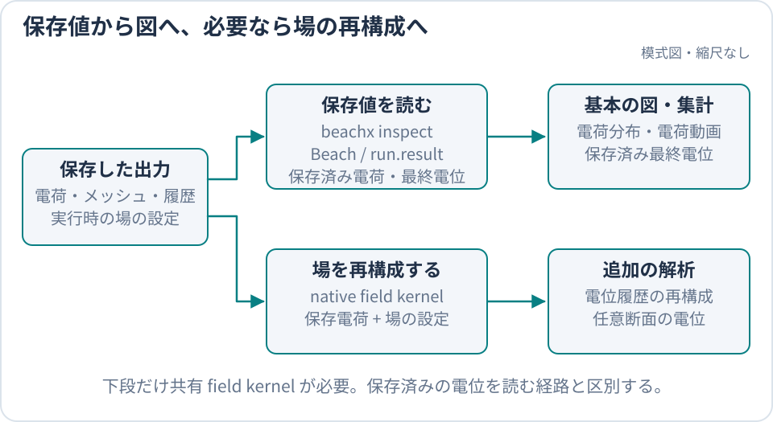

title: 後処理チュートリアル

# 後処理チュートリアル

BEACH の後処理は、実行概要を CLI で確認し、電荷履歴を動画にし、必要なときだけ Python で独自解析へ進むのが
基本です。通常の BEACH Python package だけで、作成済みの公式入門ケースの完走確認、電荷分布、保存済みの電位、
保存 batch の選択まで実行できます。

**前提:** [入門チュートリアル](../start/Tutorial.md)を完了し、現在のディレクトリに、その実行で使った
`beach.toml` と `outputs/tutorial` があります。repository の clone、repository root、
`examples/tutorial_floating_plate.toml` は必要ありません。

`outputs/tutorial` には少なくとも `summary.txt`、`charges.csv`、`mesh_triangles.csv`、
`mesh_sources.csv`、`charge_history.csv`、`mesh_potential.csv`、`potential_history.csv`、
`top_reference_history.csv` が必要です。
不足する場合は[入門チュートリアル](../start/Tutorial.md)へ戻って実行し直してください。file の意味は
[出力ファイルを調べる](OutputGuide.md)、全 class・関数は
[Python 後処理 API リファレンス](../reference/PythonPostprocessAPI.md)を参照してください。



保存済みの電荷・最終電位はそのまま描画でき、電位履歴や断面の再構成では native field kernel を使います。

## 1. `beachx inspect` で完走と分布を確認する

最初に、図を作らず実行概要を読みます。

```bash
beachx inspect outputs/tutorial
```

公式入門ケースでは、少なくとも次を確認します。

- `directory=outputs/tutorial`
- `processed_particles=15350054` と `batches=10000`
- `absorbed`、`escaped`、`charge_sum` が表示される
- 保存済み `mesh_potential.csv` の `potential_min` と `potential_max` が表示される
- `charge_history_shape` と保存された batch index が表示される
- `mesh_ids` と、mesh source ごとの `mesh_id=... source=... template=...` の行が表示される

`rng_seed=12345` での参照値は
[出力ファイルを調べる](OutputGuide.md#公式入門ケースの結果を確認する)にあります。
各行は `key=value` で、`--json` を付けると同じ内容を JSON 1 オブジェクトで出力します。

次に、同じ出力から基本図を保存します。

```bash
beachx inspect outputs/tutorial --save-dir outputs/tutorial/figures
```

正常終了すると、要素電荷の bar chart（`charge_bar.png`）、表面電荷密度で着色した mesh（`charge_mesh.png`）、
保存済み絶対電位で着色した mesh（`potential_mesh.png`）が `outputs/tutorial/figures` に保存され、
`saved_charge_bar=...` などの行で保存先が表示されます。
画像の生成は後処理の成功を示しますが、数値収束や物理的妥当性の証明ではありません。

## 2. `beachx animate` で batch 間の変化を見る

公式入門ケースは `output.history.stride_batches=10` なので、1000 個の電荷 snapshot があります。標準配布だけで使える
表面電荷密度の GIF を作ります。板は一様に帯電するので、全要素が同じ色のまま濃くなります。

```bash
beachx animate outputs/tutorial \
  --quantity charge \
  --save outputs/tutorial/charge_history.gif \
  --total-frames 30
```

正常終了すると、`saved=outputs/tutorial/charge_history.gif`、`snapshots=1000`、
`rendered_frames=30` が表示されます。

`animate` は `charge_history.csv` の保存済み snapshot を使います。`potential` mode では、その電荷と
場の再構成情報に加えて native field kernel が必要です（4 節）。履歴がない別の run は、`output.history.stride_batches` を
正にして simulation を再実行する必要があります。

## 3. Python API で図と保存 batch を選ぶ

CLI の確認が通ったら、独自の図や集計へ進みます。`config_path` には、現在のディレクトリで実行に使った
`beach.toml` を指定します。

```python
from beach import Beach

run = Beach(
    "outputs/tutorial",
    config_path="beach.toml",
)

print("absorbed:", run.result.summary.absorbed)
print("escaped:", run.result.summary.escaped)
print("batches:", run.result.summary.batches)
print("mesh ids:", run.mesh_ids)

bar_fig, _ = run.plot_bar()
bar_fig.savefig("outputs/tutorial/python_charges_bar.png", dpi=150)

charge_fig, _ = run.plot_mesh()
charge_fig.savefig("outputs/tutorial/python_charge.png", dpi=150)

potential_fig, _ = run.plot_potential()
potential_fig.savefig("outputs/tutorial/python_potential.png", dpi=150)
```

`plot_potential()` の既定 `reference_point=None` は `mesh_potential.csv` に保存された最終電位を使うため、
native field kernel は不要です。保存値と異なる基準点で再評価する場合（`reference_point=`）と、`source="kernel"` で
保存値を使わずに再計算する場合は kernel が必要で、4 節のとおりこのケースでは使えません。

### 特定の mesh と batch を選ぶ

`beachx inspect` または `mesh_sources.csv` で `mesh_id` を確認してから選択します。`step=None` は
`charges.csv` の最終電荷、整数の `step` は `charge_history.csv` に保存された batch index を表します。

```python
mesh_id = run.mesh_ids[0]

final_mesh = run.get_mesh(mesh_id, step=None)
final_charge = run.get_mesh_charge(mesh_id, step=None)
print(final_mesh.triangles.shape, final_charge.shape)

# 公式ケースは 10 batch ごとに保存するので、batch 5001 が保存されています。
mesh_at_5001 = run.get_mesh(mesh_id, step=5001)
charge_at_5001 = run.get_mesh_charge(mesh_id, step=5001)
print(mesh_at_5001.triangles.shape, charge_at_5001.shape)
```

## 4. 保存した電位履歴から電位差を描く

公式入門ケースは、10 batch ごとの要素電位（`potential_history.csv`）と流入面の平均電位（`top_reference_history.csv`）を
保存しています。板と流入面の電位差の時間変化は、この 2 つの差として kernel なしで描けます。

```python
import matplotlib.pyplot as plt
import numpy as np
from beach import load_run

result = load_run("outputs/tutorial")
batches = result.history.potential.batch_indices
plate = result.history.potential.as_array().mean(axis=0)
inlet = np.array([row.potential_mean_v for row in result.top_reference_history])

fig, ax = plt.subplots()
ax.plot(batches * 5.0e-4, plate - inlet)
ax.set_xlabel("time [s]")
ax.set_ylabel("plate - inlet potential [V]")
fig.savefig("outputs/tutorial/python_dphi.png", dpi=150)
print("last dphi [V]:", plate[-1] - inlet[-1])
```

`5.0e-4` は `run.batch.duration_s` です。最後の行は `last dphi [V]: -3.77...` のように、
[入門チュートリアル](../start/Tutorial.md#4-見積もりと比べる)の `dphi_V` と同じ値を表示します。

保存していない点の電位や電場を表面電荷から計算し直す native field kernel（`beachx animate --quantity potential`、
`beachx slices`、`source="kernel"`）は、自由空間と有限 image の periodic2 の run が対象です。公式入門ケースが使う
`fields.periodic.backend="cached_kneq0"` では、kernel が面平均成分を含まないため、これらは停止します。
kernel の用意と対象は[Python 後処理 API リファレンス](../reference/PythonPostprocessAPI.md#native-kernel-を用意する)を参照してください。

## 5. 複数物体の解析へ進む

公式入門ケースは単一の固定した板なので、物体間の力や離脱には使えません。別の複数物体 run がある場合は、
[物体の力と離脱を調べる](ObjectForcesDetachment.md)へ進んでください。
