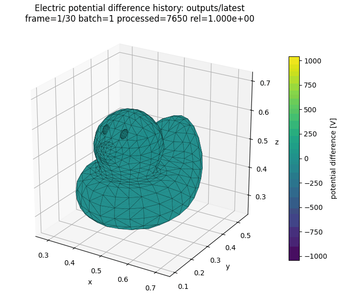

title: BEACH ドキュメント

# BEACH

BEACH は、三角形表面上の電荷から電場を求め、その場の中で荷電粒子を追跡し、
吸収された粒子の電荷を表面へ蓄積するシミュレータです。

**[入門チュートリアルを始める](start/Tutorial.md)** · [BEACH の計算サイクルを先に確認する](models/Algorithms.md)

## 最初の 30 分

初めて使う場合は、次の順に進めてください。各ページは前のページの出力を引き継ぎます。

1. [インストール](start/Installation.md) — `beach` と `beachx` を使える状態にする。
2. [入門チュートリアル](start/Tutorial.md) — 電子ビームで金属板を帯電させ、飽和電位を見積もりと比べる。
3. [出力ファイルを調べる](guide/OutputGuide.md) — `summary.txt` と `charges.csv` を読む。
4. [実行・再開する](guide/Execution.md#checkpointから一度再開する) — 150 batch の結果を 151 batch へ再開する。
5. [トラブルシューティング](guide/Troubleshooting.md) — lint、実行、出力、再開の失敗を切り分ける。

公式入門ケースは、帯電の結果を解析的な見積もりと比べられる小さなケースです。研究ケースの正常終了は、
結果の収束や物理的妥当性を意味しません。研究へ使う前に [計算結果の妥当性確認](guide/ValidationGuide.md) を行ってください。

## BEACH が扱う範囲

| BEACH が直接扱うもの | 別モデルまたは適用範囲外のもの |
| --- | --- |
| 三角形要素ごとの表面電荷 | 空間中の粒子電荷を自己無撞着に解く体積 plasma |
| 表面電荷と指定した外場が作る電場・電位 | 衝突を含む計算領域外の plasma 輸送 |
| batch 中に固定した場での荷電粒子軌道 | 物体内部の誘電分極・抵抗性伝導 |
| 表面への吸収・放出と batch ごとの電荷更新 | 一般の二次電子放出・散乱モデル |
| 必要に応じた計算領域上端の準定常境界応答 | 時間変化する外部 sheath や完全な速度分布 solver |

通常の表面電荷更新サイクルと `particles.tracking.dt_s`、`run.batch.duration_s`、`batch_count` の違いは
[BEACH の計算サイクル](models/Algorithms.md)で図解しています。外部 sheath を接続する場合の分担は
[Zhao closure](models/ZhaoStationaryClosure.md)を参照してください。

## 目的から選ぶ

| 目的 | 読む順序 |
| --- | --- |
| 研究ケースを作る | [ケースを設計する](guide/ConfigurationRecipes.md) → [`beach.toml`を作成・検証する](guide/Configuration.md) → [実行する](guide/Execution.md) → [結果を検証する](guide/ValidationGuide.md) |
| 粒子源や表面モデルを選ぶ | [粒子をどこから入れるか](guide/ParticleSourcesBoundaries.md) → [表面はどう帯電するか](models/SurfaceModels.md) |
| open 境界と return を構成する | [境界から粒子を流入させる](guide/ReservoirInjection.md) → [粒子の escape と return](models/ParticleEscapeReturn.md) |
| 光電子を扱う | [光電子の放出とライフサイクル](models/PhotoelectronEmission.md) |
| 太陽風と光電子の中の周期表面を扱う | [プラズマ中の周期表面を設定する](guide/PeriodicPlasmaSurface.md) → [外部シースとの接続](models/ZhaoStationaryClosure.md) → [電子の drift と上流の帯](models/ZhaoUpstreamBand.md) |
| 場ソルバや周期境界を選ぶ | [場の評価](guide/FieldSolvers.md) → [periodic2 静電場](models/PeriodicElectrostatics.md) |
| 出力を可視化する | [後処理チュートリアル](guide/PostprocessTutorial.md) → [Python API](reference/PythonPostprocessAPI.md) |
| ソースを変更する | [アーキテクチャ](developer/Architecture.md) → [開発とテスト](developer/Workflow.md) |

## ドキュメントの構成

### はじめる

概要、インストール、最初の実行を順に説明します。電子ビームで金属板を帯電させ、
板が電子を押し返して帯電が止まる電位を、手計算の見積もりと比べるところまで確認できます。

### ケースを作る

目的から形状、粒子源、境界条件、場 solver を選び、設定を検証して実行・再開するまでを
実際の作業順に並べています。

### 結果を調べる

最初の合否確認、可視化、数値・物理妥当性の検証、問題診断を扱います。正常終了、数値収束、
物理的妥当性を別々に確認します。

### モデルを理解する

通常の計算サイクル、表面帯電、粒子源、光電子、open 境界、Zhao 定常シース、periodic2、matching plane、
`run.batch.duration_s` を説明します。通常経路を先に読み、高度な model は必要なページだけを選びます。

### リファレンス

[入力パラメータ](reference/Parameters.md)、[出力形式](reference/OutputReference.md)、数値手法の詳細、[Python API](reference/PythonPostprocessAPI.md)、
[Fortran API](https://nkzono99.github.io/BEACH/fortran/) は、先頭から読むのではなく検索して使う資料です。

### 開発者ガイド

[アーキテクチャ](developer/Architecture.md)、[開発とテスト](developer/Workflow.md)、
[物理リリース検証](developer/PhysicsReleaseVerification.md)、生成された依存関係マップをまとめています。

## 情報の正本

| 内容 | 正本 |
| --- | --- |
| 実装済みの挙動と不変条件 | [`SPEC.md`](../SPEC.md) と Fortran 実装 |
| 入力キー、型、機械検証 | `schemas/beach.schema.json` |
| 出力ファイルの生成条件 | `schemas/beach.output-manifest.json` |
| 操作手順 | このサイトのチュートリアルとユーザーガイド |
| 数式、前提、適用限界 | モデル・数値手法の各ページ |

  
  
<i>電子ビーム照射下での絶縁体メッシュ上の電位分布の時間発展</i>

  3D model: <a href="https://www.turbosquid.com/ja/3d-models/rubber-duck-pbr-game-ready-model-2001526">Rubber Duck PBR Game Ready</a> (TurboSquid)

