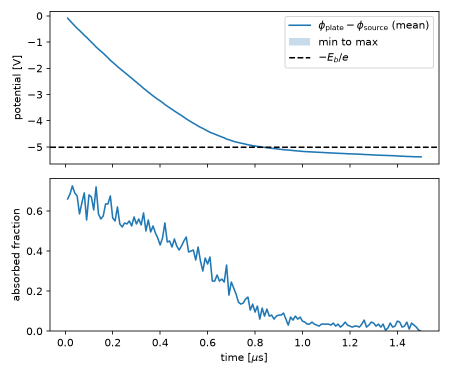
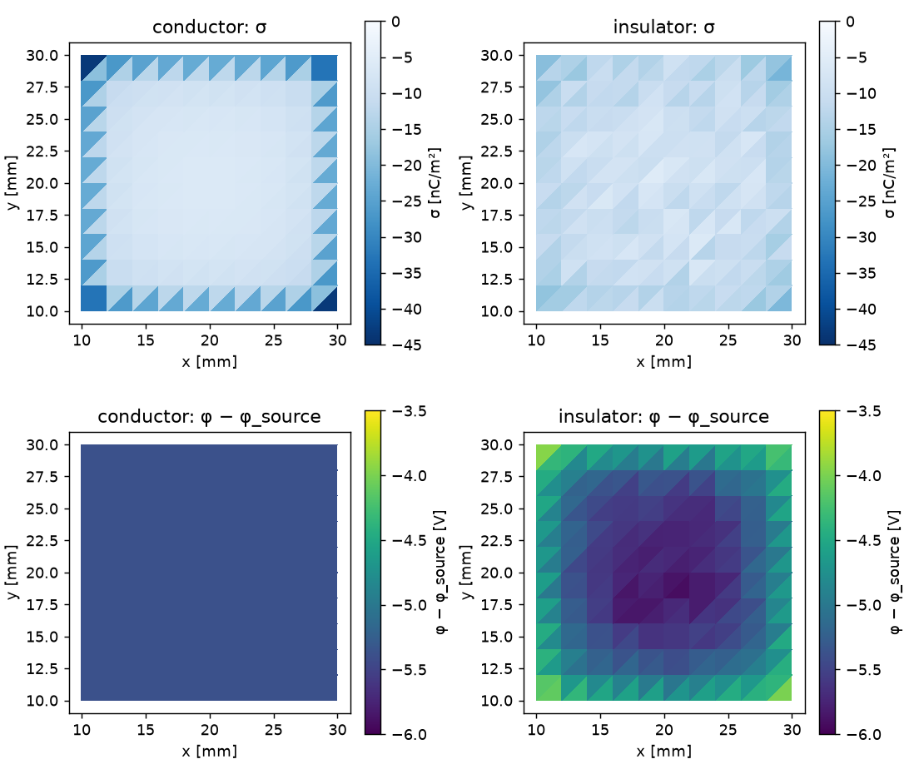

title: 入門: 電子ビームで金属板を帯電させる

# 入門: 電子ビームで金属板を帯電させる

真空中で、絶縁された金属板に 5 eV の電子ビームを当て続けます。板は負に帯電し、やがて電子を押し返して
帯電が止まります。このページでは、何が起きるかを先に手計算で見積もり、BEACH の結果がその見積もりと
合うことを確かめます。最後に板を絶縁体に替えて、帯電の仕方の違いを見ます。

低エネルギーの電子を当てて試料の電位を抑える flood gun と同じ原理で、表面帯電の基本である
「電流が帯電を作り、帯電が電流を変える」という帰還を、解析的に確かめられる形で体験できます。

## 0. インストールを確認する

```bash
beach --version
beachx --help
```

両方が実行できれば準備完了です。見つからない場合は[インストール](Installation.md)を確認してください。
HPC のログインノードでは実行せず、計算ノードの割当内で以降のコマンドを実行します。

## 1. 何が起きるかを見積もる

計算の前に、条件と期待される結果を書き出します。

| 量 | 値 |
| --- | --- |
| 金属板 | 一辺 20 mm の正方形、厚さ無視。どこにも接続されていない（浮遊導体） |
| ビーム | エネルギー $E_b=5$ eV、エネルギー幅 約 0.3 eV、一辺 24 mm の正方形断面 |
| 電流密度 | $J\approx2.2\ \mu\mathrm{A/cm^2}$（ビーム全体で 12.8 μA） |
| 放出面と板の距離 | 50 mm |

**板に当たる電流。** ビームの断面のうち板に重なるのは $(20/24)^2\approx0.69$ なので、帯電の初期には
約 8.9 μA が板に入ります。

**帯電が止まる条件。** 電子は放出面から板まで、エネルギー保存 $\tfrac12mv^2-e\phi=\text{一定}$ に従って進みます。
板の電位が放出面より $E_b/e$ だけ低くなると、電子は板に届かず押し返されます。

$$
\phi_{\mathrm{plate}}-\phi_{\mathrm{source}}\approx-\frac{E_b}{e}=-5\ \mathrm{V}
$$

**そのときの電荷。** 同じ面積の円板の容量 $C=8\epsilon_0r$（$r=\sqrt{A/\pi}=11.3$ mm）は 0.80 pF です。
放出面の電位も板の電荷によって $Q/(4\pi\epsilon_0 d)$（$d=50$ mm）だけ下がるので、

$$
\frac{Q}{C}-\frac{Q}{4\pi\epsilon_0d}=5\ \mathrm{V}
\quad\Rightarrow\quad
Q\approx4.7\ \mathrm{pC},\quad\phi_{\mathrm{plate}}\approx-5.8\ \mathrm{V},\quad\phi_{\mathrm{source}}\approx-0.8\ \mathrm{V}
$$

です。

**かかる時間。** 8.9 μA で 4.7 pC を運ぶと約 0.5 μs です。実際には、帯電した板が電子を横へそらして
当たる電流が減るので、これより長くなります。

**BEACH の前提が成り立つか。** BEACH は電子どうしの空間電荷を解かず、表面電荷の場だけで電子を追跡します。
このビームの電子密度は $n=J/(ev)\approx10^5\ \mathrm{m^{-3}}$ と非常に小さく、ビーム自身が作る電位は
$10^{-7}$ V 程度なので、無視して構いません。

## 2. 設定を作る

```bash
mkdir beach-tutorial
cd beach-tutorial
beachx config init beach.toml
beachx lint beach.toml
```

`status=ok` が表示されれば設定は有効です。生成される設定は
[`examples/tutorial_electron_beam.toml`](https://github.com/Nkzono99/BEACH/blob/main/examples/tutorial_electron_beam.toml)
と同じ値です。見積もりの条件は、次のキーに対応します。

| 物理条件 | 設定 | 値 |
| --- | --- | --- |
| 金属板 | `mesh.parts` の `kind="plane"`、`surface_model="conductor"` | 20 mm 四方、10×10 区画（200 三角形） |
| ビームエネルギー | `distribution.drift_velocity_m_s` | $-1.3262\times10^6$ m/s（5.0 eV） |
| エネルギー幅 | `distribution.temperature_ev` | 0.01 eV。drift した分布ではエネルギー幅 約 0.32 eV になる |
| 放出面 | `source.pos_low` / `source.pos_high` | 高さ 60 mm の 24 mm 四方（板は高さ 10 mm） |
| 電流 | `sampling.volume_macro_particles_per_batch` × `sampling.weight` × $e$ ÷ `run.batch.duration_s` | 200 × 4000 × $e$ ÷ 10 ns = 12.8 μA |
| 計算する時間 | `run.batch_count` × `run.batch.duration_s` | 150 × 10 ns = 1.5 μs |
| 軌道の刻み | `particles.tracking.dt_s` / `max_steps_per_particle` | 0.2 ns / 1500 step（1 個の電子を 300 ns まで追跡） |

`sampling.weight` は、1 個の計算粒子が表す実際の電子の数です。電流密度 $J$、ビーム断面積 $A$、
バッチ幅 $h$、計算粒子数 $N$ から $w=JAh/(eN)$ で決めます。

BEACH は、1 バッチの間は場を固定して電子を追跡し、吸収された電荷をバッチの最後にまとめて板へ反映します。
1 バッチで板に入る電荷（約 89 fC）による電位の変化は約 0.1 V で、ビームのエネルギー幅（0.3 eV）より小さいので、
バッチごとの階段状の帯電が飽和点を行き過ぎることはありません。

## 3. 実行する

```bash
beach beach.toml
beachx inspect outputs/tutorial
```

8 thread で約 1 分、1 thread で約 8 分かかります。結果は thread 数によらず同じです。
`beachx inspect` には次の値が表示されます。

```text
processed_particles=30000
absorbed=7769
escaped=22231
batches=150
simulated_time_s=1.500000e-06
charge_sum=-4.978924e-12
potential_min=-6.256043e+00
potential_max=-6.256043e+00
```

`potential_min` と `potential_max` が一致しているのは、板が導体で等電位だからです。電位は無限遠を 0 V とした値です。

## 4. 見積もりと比べる

放出面の電位を含めて比べるため、解析スクリプトを取得して実行します。

```bash
curl -O https://raw.githubusercontent.com/Nkzono99/BEACH/main/examples/tutorial_beam_analysis.py
python tutorial_beam_analysis.py outputs/tutorial --save-plot outputs/tutorial/charging.png
```

```text
beam_energy_eV=5.000
beam_current_A=1.2817e-05 beam_current_density_uA_cm2=2.225
geometric_hit_fraction=0.694
batch time_us absorbed_fraction plate_charge_C phi_plate_V phi_source_V phi_plate_minus_source_V(min/mean/max)
    1   0.010  0.660 -8.4595e-14  -0.106  -0.015  -0.091/ -0.091/ -0.091
   26   0.260  0.535 -2.0649e-12  -2.595  -0.365  -2.230/ -2.230/ -2.230
   51   0.510  0.470 -3.6382e-12  -4.571  -0.643  -3.928/ -3.928/ -3.928
   76   0.760  0.160 -4.5310e-12  -5.693  -0.801  -4.892/ -4.892/ -4.892
  101   1.010  0.045 -4.7931e-12  -6.023  -0.847  -5.175/ -5.175/ -5.175
  126   1.260  0.055 -4.8963e-12  -6.152  -0.865  -5.287/ -5.287/ -5.287
  150   1.500  0.000 -4.9789e-12  -6.256  -0.880  -5.376/ -5.376/ -5.376
capacitance_from_run_pF=0.796
capacitance_equal_area_disk_pF=0.799
```



| 見積もり | BEACH | 読み方 |
| --- | --- | --- |
| 初期に当たる割合 0.69 | 0.66 | 差はエネルギー幅による広がりと、帯電による偏向 |
| 電位差 −5 V で飽和 | −5.38 V で吸収がほぼ 0 | エネルギー幅 0.32 eV の高エネルギー側の電子が、−5 V を越えても少しずつ届く |
| 電荷 4.7 pC | 4.98 pC | 飽和電位差が 5.38 V になった分だけ多い（4.7 pC × 5.38/5 ≈ 5.0 pC） |
| 容量 0.80 pF（同面積の円板） | 0.796 pF | 要素を細かくすると正方形板の値に近づく |
| 時間 約 0.5 μs 以上 | 約 0.85 μs で −5 V に達する | 帯電した板が電子をそらし、当たる割合が下がるため |

放出面の電位 `phi_source_V` は、板の電荷を点電荷とみなした和です。放出面までの距離（50 mm）が
要素の大きさ（2 mm）より十分大きいので、この近似で足ります。三角形要素の電荷分布から厳密に評価する
[後処理チュートリアル](../guide/PostprocessTutorial.md)の native field kernel を使っても、1.5 μs 後の値は −0.880 V で一致します。

## 5. 絶縁体に替える

`beach.toml` の `surface_model` を `"insulator"`、`output.dir` を `"outputs/insulator"` に替えて実行します。

```bash
sed -e 's/surface_model = "conductor"/surface_model = "insulator"/' \
    -e 's#dir = "outputs/tutorial"#dir = "outputs/insulator"#' beach.toml > insulator.toml
beach insulator.toml
python tutorial_beam_analysis.py outputs/insulator --config insulator.toml --every 50
```

```text
batch time_us absorbed_fraction plate_charge_C phi_plate_V phi_source_V phi_plate_minus_source_V(min/mean/max)
    1   0.010  0.660 -8.4595e-14  -0.112  -0.015  -0.151/ -0.097/ -0.053
   51   0.510  0.450 -3.5543e-12  -4.734  -0.630  -4.941/ -4.104/ -2.789
  101   1.010  0.030 -4.3932e-12  -5.786  -0.779  -5.783/ -5.007/ -3.642
  150   1.500  0.015 -4.5662e-12  -5.988  -0.809  -5.915/ -5.179/ -3.952
```



絶縁体は電荷を当たった場所に保持し、板の上で動かしません。そのため電位は一様にならず、中央が −5.9 V、
角が −4.0 V になります。角の電位は −5 V に届いていないのに、吸収はほぼ止まっています。エネルギーは足りているので、
届かないのは軌道がそれるためです。中央に溜まった電荷が電子を外側へそらし、角に届く前に板の外へ逃がします。金属板では電荷が自由に動いて端と角に集まり、
板全体が同じ電位になります。

## 6. この結果が示すこと・示さないこと

この計算で確かめたのは、電子の吸収が表面電荷を作り、その電荷の場が次の電子の軌道を変えるという帰還を、
BEACH がエネルギー保存と静電容量の見積もりに合う形で解いていることです。

次のことは、このケースには含まれていません。

- 二次電子放出と後方散乱。実際の材料では数 eV の電子でも無視できない割合が反射されます。
  BEACH の[二次電子放出](../models/SecondaryElectronEmission.md)のモデルは使えますが、材料ごとの値が必要です。
- 電子銃の電極や周囲の導体。このケースの電位は無限遠を 0 V とした真空中の値です。
- 要素分割への依存。`nx`、`ny` を 20 にすると容量が変わります。研究に使う前に、
  [計算結果の妥当性確認](../guide/ValidationGuide.md)に従って分割、時間刻み、粒子数への依存を調べます。

## 7. 次へ進む

| 目的 | 次に読むページ |
| --- | --- |
| 各出力ファイルと保存則を確認する | [出力ファイルを調べる](../guide/OutputGuide.md) |
| 計算を延長する（checkpoint から再開する） | [実行・再開する](../guide/Execution.md#checkpointから一度再開する) |
| 図を作る | [後処理チュートリアル](../guide/PostprocessTutorial.md) |
| 自分のケースを作る | [ケース設計の流れ](../guide/ConfigurationRecipes.md) |
| モデルと数値手法を理解する | [技術原稿](https://nkzono99.github.io/BEACH/theory.html) |
| 実行に失敗した | [トラブルシューティング](../guide/Troubleshooting.md) |
