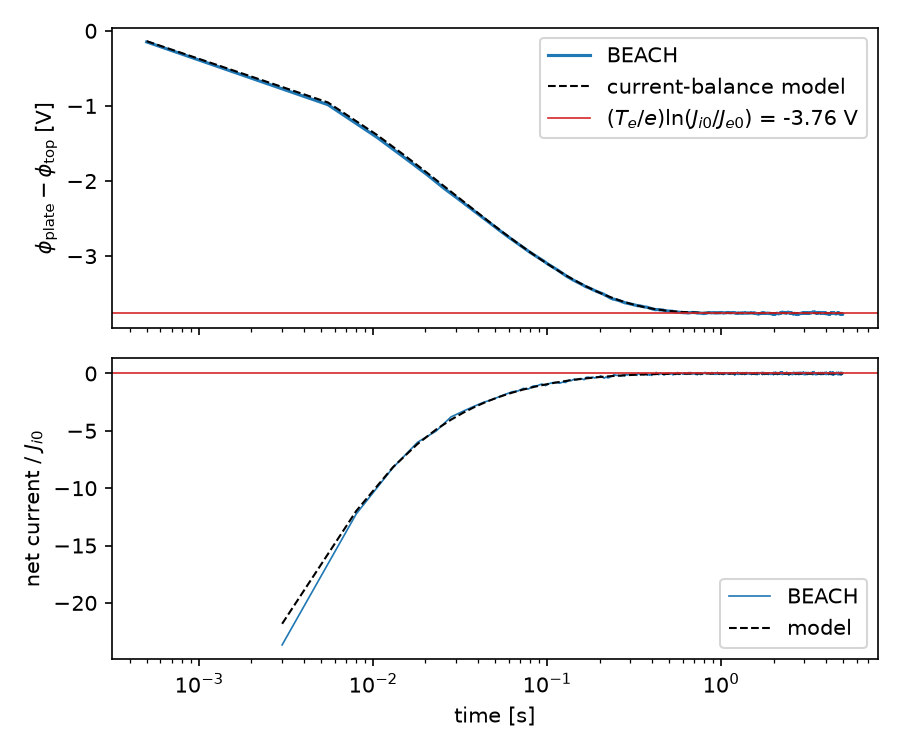
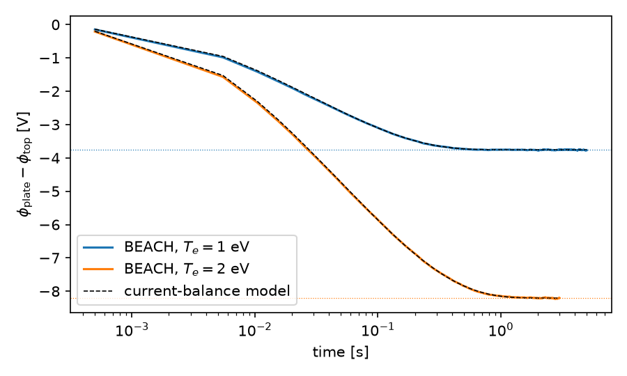

title: 入門: プラズマ中の金属板の浮遊電位

# 入門: プラズマ中の金属板の浮遊電位

電子と陽子からなるプラズマの中に、どこにも接続されていない金属板を置きます。電子は陽子より速いので、
はじめは電子の電流が勝ち、板は負に帯電します。負の板は電子を押し返し、陽子を引き寄せます。電子と陽子の電流が
釣り合うと帯電が止まり、板はその電位（浮遊電位）にとどまります。このページでは、浮遊電位とそこに至る時間を
先に手計算で見積もり、BEACH の結果がその見積もりと合うことを確かめます。最後に電子温度を変えて、
浮遊電位が電子温度とともに深くなることを確かめます。

浮遊電位は、宇宙機や探査機の表面帯電で最初に見積もる量です。表面帯電の基本である
「電流が帯電を作り、帯電が電流を変える」という帰還を、解析解と比べられる形で体験できます。

## 0. インストールを確認する

```bash
beach --version
beachx --help
```

両方が実行できれば準備完了です。見つからない場合は[インストール](Installation.md)を確認してください。
HPC のログインノードでは実行せず、計算ノードの割当内で以降のコマンドを実行します。

## 1. 何が起きるかを見積もる

計算の前に、条件と期待される結果を書き出します。

| 量 | 値 |
| --- | --- |
| プラズマ | 電子と陽子。密度 $n=1\ \mathrm{cm^{-3}}$、温度 $T_e=T_i=1$ eV、流れなし |
| 金属板 | 一辺 10 cm の正方形を x/y 方向に周期的に並べた無限平面。どこにも接続されていない（浮遊導体） |
| 流入面 | 板から $d=10$ cm 上の面。この面より上は一様なプラズマで、板の電位はこの面との差で測る |

**流入する電流。** 流入面を下向きに横切る粒子の数は、Maxwell 分布の片側の束
$\Gamma=n\sqrt{T/(2\pi m)}$ です。電流密度にすると

$$
J_{e0}=e\Gamma_e=2.68\times10^{-8}\ \mathrm{A/m^2},\qquad
J_{i0}=e\Gamma_i=6.26\times10^{-10}\ \mathrm{A/m^2}
$$

で、比は $J_{e0}/J_{i0}=\sqrt{m_p/m_e}=42.8$ です。

**板に届く電流。** 板の電位が流入面より $\Delta\phi$（$<0$）だけ低いとき、陽子はすべて板に届きます。電子は、
板に垂直な向きの運動エネルギーが $-e\Delta\phi$ を超えるものだけが届きます。Maxwell 分布では、その割合は
$\exp(e\Delta\phi/T_e)$ です。この割合は、板と流入面の間で電位が単調に変わる限り、途中の電位の形によらず電位差だけで決まります。

**帯電が止まる条件。** 電子と陽子の電流が等しくなる電位差は

$$
J_{i0}=J_{e0}\exp\!\left(\frac{e\Delta\phi}{T_e}\right)
\quad\Rightarrow\quad
\Delta\phi=\frac{T_e}{e}\ln\frac{J_{i0}}{J_{e0}}=-\frac{T_e}{2e}\ln\frac{m_p}{m_e}=-3.758\ \mathrm{V}
$$

です（2 番目の等号は $T_e=T_i$ のとき）。

**そのときの電荷。** 板の下は物体の内部で電場がないとすると、板の面電荷密度 $\sigma$ は板の上に一様な電場
$\sigma/\epsilon_0$ を作り、流入面との電位差は $\Delta\phi=\sigma d/\epsilon_0$ です。したがって

$$
\sigma=\frac{\epsilon_0\Delta\phi}{d}=-3.327\times10^{-10}\ \mathrm{C/m^2}
$$

で、周期の 1 区画（100 cm²）あたり −3.33 pC です。

**かかる時間。** 板の単位面積あたりの容量は $\epsilon_0/d$ です。板に入る正味の電流で電荷が変わる式
$(\epsilon_0/d)\,d\Delta\phi/dt=J_{i0}-J_{e0}\exp(e\Delta\phi/T_e)$ を解くと、

$$
\exp\!\left(-\frac{e\Delta\phi}{T_e}\right)=R-(R-1)\,e^{-t/\tau},
\qquad
R=\frac{J_{e0}}{J_{i0}}=42.8,
\qquad
\tau=\frac{\epsilon_0T_e}{e\,d\,J_{i0}}=0.142\ \mathrm{s}
$$

です。電位差は約 $3.5\tau=0.5$ s で最終値の 1% 以内に近づきます。

**BEACH の前提が成り立つか。** BEACH は空間中の粒子の電荷（空間電荷）を解かず、表面電荷の場だけで粒子を追跡します。
板と流入面の間にある粒子の電荷は多く見積もっても $e\,n\,d=1.6\times10^{-14}\ \mathrm{C/m^2}$ で、板の電荷の $5\times10^{-5}$ 倍です。
言い換えると、間隔 $d=10$ cm はこのプラズマのデバイ長 $\lambda_D=\sqrt{\epsilon_0T_e/(e^2n)}=7.4$ m より十分短いので、
空間電荷は無視できます。

## 2. 設定を作る

```bash
mkdir beach-tutorial
cd beach-tutorial
beachx config init beach.toml
beachx lint beach.toml
```

`status=ok` が表示されれば設定は有効です。生成される設定は
[`examples/tutorial_floating_plate.toml`](https://github.com/Nkzono99/BEACH/blob/main/examples/tutorial_floating_plate.toml)
と同じ値です。見積もりの条件は、次のキーに対応します。

| 物理条件 | 設定 | 値 |
| --- | --- | --- |
| プラズマ | 各 species の `distribution.number_density_cm3`、`temperature_ev`、`drift_velocity_m_s` | 1 cm⁻³、1 eV、0 |
| 流入面からの流入 | `inflow.z_high="reservoir"`、`particles.reservoir.inflow_model="source_vdf"` | 上端面で片側 Maxwell 分布の束を入れる |
| 周期平面 | `domain.periodic_axes=["x","y"]`、`fields.boundary="periodic2"` | 一辺 10 cm の区画を x/y 方向に繰り返す |
| 遠くの区画の場 | `fields.solver.method="fmm"`、`fields.periodic.backend="cached_kneq0"` | 無限に繰り返す板の場を含める |
| 金属板 | `mesh.parts` の `kind="plane"`、`surface_model="conductor"` | 高さ 1 cm、2×2 区画（8 三角形） |
| 板の下で電場 0 | `fields.periodic.lower_boundary_model` | `"e_bottom_zero"` |
| 流入面の高さ | `domain.box_max` の z | 11 cm（$d=10$ cm） |
| 電荷の更新間隔 | `run.batch.duration_s` | 0.5 ms（$\tau/283$） |
| 計算する時間 | `run.batch_count` × `run.batch.duration_s` | 10000 × 0.5 ms = 5 s（$35\tau$） |
| 標本数 | 電子の `sampling.target_macro_particles_per_batch` | 1500。陽子の `-1` は電子と同じ重みを使う指定 |
| 軌道の刻み | `particles.tracking.dt_s` / `max_steps_per_particle` | 10 ns / 3000 step（1 個の粒子を 30 μs まで追跡） |
| 出力 | `output.history.stride_batches` / `output.checkpoint.stride_batches` | 10 batch ごとの履歴、5000 batch ごとの checkpoint |

板は一様に帯電するので、要素を細かく分けても結果は変わりません。電荷の更新は既定の `charging.closure="explicit"` で、
追跡で吸収された電荷をそのまま板へ反映します。

**バッチ幅。** BEACH は、1 バッチの間は場を固定して粒子を追跡し、吸収された電荷をバッチの最後にまとめて板へ反映します。
1 バッチに陽子が運ぶ電荷は電位にして $T_e h/(e\tau)=3.5$ mV（$h$ はバッチ幅）、電子の電流が陽子の 43 倍ある帯電の初期でも
1 バッチの変化は 0.15 V です。どちらも $T_e/e$ より十分小さいので、バッチごとの階段状の更新は釣り合いの電位を行き過ぎません。

**標本数と揺らぎ。** 1 バッチに流入する電子 1500 個のうち、定常で板に届くのは $1500\,e^{-3.758}\approx35$ 個で、
同じ重みの陽子の流入数 35 個と釣り合います。届く電子の数は $\sqrt{35}$ 個程度ばらつくので、電位は 1 バッチごとに
0.6 mV 程度乱され、その乱れは時定数 $\tau$ で減衰します。その結果、定常での電位差の標準偏差は
$(T_e/e)\sqrt{h/(2\tau\cdot35)}\approx7$ mV と見積もれ、$T_e/e$ に比べて十分小さくなります。

**軌道の刻み。** 電子は折り返して流入面へ戻るまでに平均 16 step、陽子は板に届くまでに最大 750 step かかります。
`max_steps_per_particle=3000` は、電場がまだ弱い最初の数バッチの遅い陽子まで追跡するための余裕です。
一様な電場の中では軌道の計算に誤差がなく、刻みの影響は、板のすぐ手前で折り返す電子を吸収と判定するかどうかに限られます
（電位差にして 2 mV 程度）。

## 3. 実行する

```bash
beach beach.toml
beachx inspect outputs/tutorial
```

8 thread で約 10 分、1 thread で約 75 分かかります（結果は thread 数によらず同じです）。最初の実行では、x/y 方向に繰り返す遠くの区画の場を表す演算子を
作って保存し（既定では `~/.cache/beach/periodic2`。書き込めない環境では環境変数 `BEACH_CACHE_DIR` で保存先を指定）、
2 回目からはそれを再利用します。
`beachx inspect` には次の値が表示されます（`batch_indices` などの長い行は省略）。

```text
directory=outputs/tutorial
mesh_nelem=8
processed_particles=15350054
absorbed=737481
escaped=14612573
batches=10000
last_rel_change=...
simulated_time_s=5.000000e+00
charge_sum=-3.339396e-12
mesh_ids=[1]
mesh_id=1 source=template template=plane surface=conductor epsilon_r=1.000000e+00 elems=8
potential_min=1.338411e-05
potential_max=1.338411e-05
charge_history_shape=[8,1000]
```

`potential_min` と `potential_max` が一致しているのは、板が導体で等電位だからです。periodic2 の電位の基準点は
任意なので、この値そのものではなく、流入面の電位との差を次の節で読みます。

## 4. 見積もりと比べる

流入面との電位差と、粒子種ごとの吸収数を比べるため、解析スクリプトを取得して実行します。

```bash
curl -O https://raw.githubusercontent.com/Nkzono99/BEACH/main/examples/tutorial_floating_analysis.py
python tutorial_floating_analysis.py outputs/tutorial --save-plot outputs/tutorial/floating.png
```

```text
electron_temperature_eV=1.000 gap_m=0.1000 area_m2=1.0000e-02
inflow_current_density_A_m2 electron=2.6806e-08 proton=6.2557e-10 ratio=42.85
expected_dphi_V=-3.758 expected_charge_density_C_m2=-3.3272e-10
relaxation_time_s=0.1415 relaxation_batches=283
batch   time_s   dphi_V  model_V  charge_density_C_m2
     1   0.001   -0.148   -0.138  -1.3090e-11
  1001   0.501   -3.733   -3.729  -3.3054e-10
  2001   1.000   -3.750   -3.757  -3.3207e-10
  3001   1.500   -3.756   -3.758  -3.3253e-10
  4001   2.001   -3.770   -3.758  -3.3383e-10
  5001   2.501   -3.761   -3.758  -3.3298e-10
  6001   3.001   -3.751   -3.758  -3.3213e-10
  7001   3.501   -3.754   -3.758  -3.3236e-10
  8001   4.000   -3.759   -3.758  -3.3280e-10
  9001   4.500   -3.761   -3.758  -3.3303e-10
  9991   4.995   -3.772   -3.758  -3.3395e-10
steady_window_batches=5001-10000
steady_dphi_V mean=-3.7603 std=0.0067 expected=-3.7577
steady_charge_density_C_m2 mean=-3.3295e-10
window_electron injected=7500000 absorbed=175129 fraction=0.02335 expected_fraction=0.02328 absorbed_current_A_m2=6.2593e-10 expected_current_A_m2=6.2399e-10
window_proton injected=175028 absorbed=175028 fraction=1.00000 expected_fraction=1.00000 absorbed_current_A_m2=6.2557e-10 expected_current_A_m2=6.2557e-10
survived_max_step=1
```



`dphi_V` は板の電位から流入面の平均電位（`top_reference_history.csv`）を引いた値、`model_V` は 1 節の式です。
`window_*` の行は、5000 batch 目の checkpoint から最後までの 5000 batch に流入・吸収したマクロ粒子数です。
`expected_fraction` は、電子では窓内の電位差から求めた $\exp(e\Delta\phi/T_e)$ の平均、陽子では 1 です。

| 見積もり | BEACH | 読み方 |
| --- | --- | --- |
| 釣り合いの電位差 −3.758 V | 後半 5000 batch の平均 −3.760 V | 差 2.6 mV は平均の統計誤差と同程度。揺らぎの相関時間は $\tau$（283 batch）なので、5000 batch の平均は独立な標本 9 個分で、統計誤差は $6.7/\sqrt{9}\approx2$ mV |
| 揺らぎの標準偏差 約 7 mV | 6.7 mV | 2 節の見積もりどおり |
| 面電荷密度 $-3.327\times10^{-10}$ C/m² | $-3.330\times10^{-10}$ C/m² | 電位差と同じ 0.07% の差 |
| 時間変化（1 節の式、$\tau=0.142$ s） | `model_V` と図の破線に重なる | 最初の数 batch だけ、バッチごとの更新が連続の式より速く進む（batch 1 で −0.148 V と −0.138 V） |
| 陽子はすべて届く | 窓内の 175028 個すべてが吸収 | 吸収電流は $J_{i0}=6.256\times10^{-10}$ A/m² に一致 |
| 電子は $\exp(e\Delta\phi/T_e)=0.02328$ の割合で届く | 0.02335（175129 個） | 差 0.3% は吸収数の統計誤差 $1/\sqrt{175129}=0.24\%$ と同程度 |
| 定常では電子と陽子の吸収電流が等しい | 6.2593 と $6.2557\times10^{-10}$ A/m² | 同じ重みなので、吸収数の差 101 個が窓の間の板の電荷の変化 |

`survived_max_step=1` は、電場がまだ弱い最初の数バッチで、遅い陽子 1 個が 30 μs の追跡時間に収まらなかったことを示します。
この陽子の電荷は板へ入らず、未解決として記録されます。1 個分の電荷は板の電荷の $3\times10^{-5}$ 倍で、結果に影響しません。

## 5. 電子温度を変える

電子の `temperature_ev` だけを 2.0 に変えて、浮遊電位が電子温度でどう変わるかを確かめます。陽子の温度は 1 eV のままです。

$$
\Delta\phi=\frac{T_e}{e}\ln\frac{J_{i0}}{J_{e0}}=-\frac{T_e}{2e}\ln\!\left(\frac{T_e}{T_i}\frac{m_p}{m_e}\right)=-8.209\ \mathrm{V}
$$

電子温度を 2 倍にすると、電位差は 2 倍より深く（2.18 倍）なります。電子の束が $\sqrt{T_e}$ に比例して増え、
対数の中身も大きくなるためです。時定数 $\tau$ は $T_e$ に比例して 0.283 s（566 batch）になるので、計算を 6000 batch
（$10.6\tau$）にし、checkpoint を 3000 batch ごとにして後半を定常の窓にします。

```bash
sed -e '/species_key = "electron"/,/species_key = "proton"/s/temperature_ev = 1.0/temperature_ev = 2.0/' \
    -e 's/batch_count = 10000/batch_count = 6000/' \
    -e 's/stride_batches = 5000/stride_batches = 3000/' \
    -e 's#dir = "outputs/tutorial"#dir = "outputs/te2"#' beach.toml > te2.toml
beach te2.toml
python tutorial_floating_analysis.py outputs/te2 --config te2.toml
```

8 thread で約 4 分かかります。出力の主な行は次のとおりです。

```text
expected_dphi_V=-8.209 expected_charge_density_C_m2=-7.2680e-10
relaxation_time_s=0.2831 relaxation_batches=566
...
steady_window_batches=3001-6000
steady_dphi_V mean=-8.2035 std=0.0105 expected=-8.2086
window_electron injected=4500000 absorbed=74380 fraction=0.01653 expected_fraction=0.01654 ...
window_proton injected=74258 absorbed=74258 fraction=1.00000 expected_fraction=1.00000 ...
```



後半 3000 batch の平均 −8.204 V と見積もり −8.209 V の差 5 mV は、平均の統計誤差（標準偏差 10 mV、相関時間 566 batch から約 6 mV）の範囲で、
時間変化も 1 節の式に重なります。
陽子はすべて、電子は 0.01653 の割合（見積もり 0.01654）で板に届きます。電子温度 1 eV の計算と並べると、
電位差は 2.18 倍、時定数は 2 倍になっています。

## 6. この結果が示すこと・示さないこと

この計算で確かめたのは、粒子の吸収が表面電荷を作り、その電荷の場が次の粒子の軌道を変えるという帰還を、
BEACH が電流の釣り合いと時定数の見積もりに合う形で解いていることです。

次のことは、このケースには含まれていません。

- 空間電荷とシース。密度が高く、デバイ長が板と流入面の間隔より短いプラズマでは、粒子の電荷が板の前にシースを作り、
  陽子はシースの手前で加速されてから板に届きます（Bohm の条件）。浮遊電位の値も変わります。BEACH は空間電荷を解かないので、
  そのような場合は[外部シースとの接続](../models/ZhaoStationaryClosure.md)を使います。
- 光電子と二次電子。日照下の表面では光電子の放出が電流の釣り合いを支配し、板が正に帯電することもあります。
  [光電子の放出](../models/PhotoelectronEmission.md)と[二次電子放出](../models/SecondaryElectronEmission.md)のモデルは使えますが、
  材料ごとの値が必要です。
- プラズマの流れと磁場、端のある有限の板。
- 時間刻み、バッチ幅、粒子数への依存。研究に使う前に、[計算結果の妥当性確認](../guide/ValidationGuide.md)に従って調べます。

## 7. 次へ進む

| 目的 | 次に読むページ |
| --- | --- |
| 各出力ファイルと保存則を確認する | [出力ファイルを調べる](../guide/OutputGuide.md) |
| 計算を延長する（checkpoint から再開する） | [実行・再開する](../guide/Execution.md#checkpointから一度再開する) |
| 図を作る | [後処理チュートリアル](../guide/PostprocessTutorial.md) |
| 自分のケースを作る | [ケース設計の流れ](../guide/ConfigurationRecipes.md) |
| 境界からの流入を詳しく知る | [境界から粒子を流入させる](../guide/ReservoirInjection.md) |
| モデルと数値手法を理解する | [技術原稿](https://nkzono99.github.io/BEACH/theory.html) |
| 実行に失敗した | [トラブルシューティング](../guide/Troubleshooting.md) |
